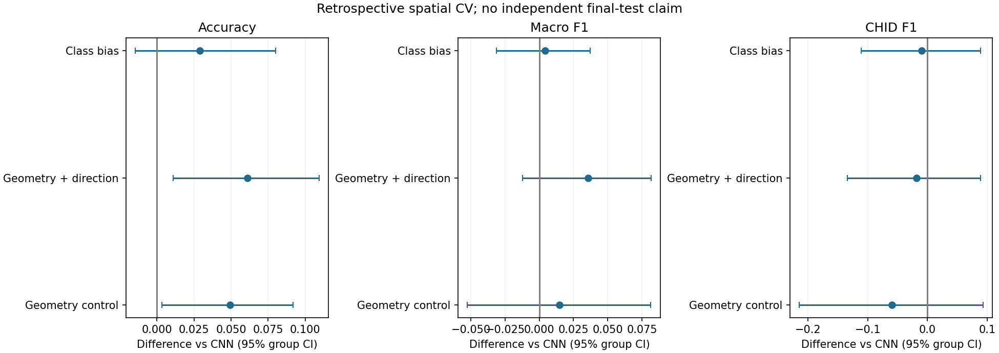
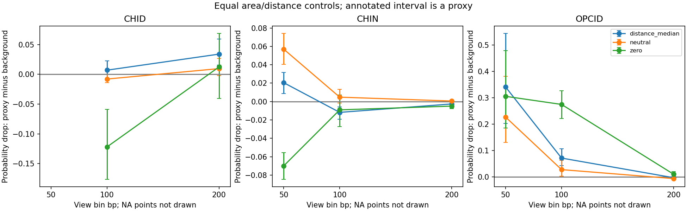
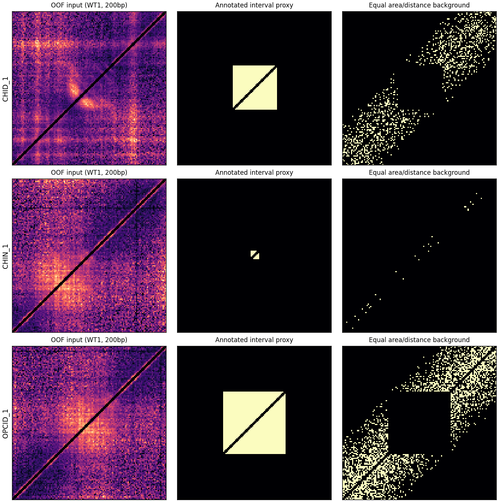

# 第八轮：分类性能定向优化与必做任务证据补齐

## 最终回答

- **任务一是否可信改善：整体准确率有空间配对支持的提升，但CHID短板未解决，未达到正式替换门槛。** 方向方案Accuracy=0.808140，较CNN差+0.061047，95%区间[0.010802,0.109598]；macroF1=0.651934，差值区间[-0.012337,0.081909]跨零。没有方案达到预先规定的可信替换门槛；保留现有正式CNN。本轮仅检验两个机制，不再扩展网格或按外层结果调参。
- **CHID主要问题：** 两类形态与决策的混淆集中在CHID/CHIN，且类别少、空间折数量不均；单纯提高CHID召回未解决误报。证据支持这些限制，不能证明唯一因果原因，也不能断言细节不可识别。
- **任务二真实独立证据：没有。** 用户确认暂缺人员，仍0/243；原公开包和评分冻结文件未变。已交付独立复核操作说明与真实导入/修订/分歧工具检查，临时测试记录已销毁。
- **任务三：核心具体要求已有证据支持满足。** 两套真实三条件、四面板、连续全基因组覆盖；本轮核对全缓存合并与30个原始点，定向查看14张。没有声称所有930张均已视觉审核。
- **任务五：没有新的证据支持重开大规模搜索。** 复用第七轮强插值、多尺度/守恒取舍结论，未训练或改选超分辨模型。
- **提交硬要求：** 正式报告的设计思路、最终代码ZIP、PPT讲解视频、组号/姓名/学号与贡献百分比、规定命名和分别提交仍需最终确认与制作；本轮没有擅自修改正式成果或推送。

## 1. 第七轮状态与本轮工作清单

实际分支 `main`，HEAD `f44d34892b2786f9804f1d40a5f24b7d9f21b89a`。第七轮658条修改/产物清单已逐条复核；本轮开始时记录1623个原文件哈希（含用户未提交修改、历史模型、数据缓存及第七轮产物）。最后完整性核验见 `verification/final_status.json`，不能将本轮源码快照当作已提交Git版本。

| priority | item | current | acceptance |
| --- | --- | --- | --- |
| 1 | 分类错误与历史方案审计 | 已实际复核全部折外行及合法质量特征 | 逐类、逐组、逐折、置信度、FP/FN和不利方案均保留 |
| 2 | 至多两种定向分类方法 | 需审计后冻结方案；不重复旧网格 | 空间隔离、训练内拟合、外层同例比较与配对不确定性 |
| 3 | 结构特异性遮挡 | 旧中心/角落不是标注结构区域 | 标注区间代理、等面积等距离支持背景、多填充值与失败例 |
| 4 | 真实独立候选复核 | 第七轮包保留，实际人员待提供 | 人员独立性与真实记录；无记录仍0/243 |
| 5 | 任务三定向核验 | 连续索引和首中末6张检查复用 | 按条件、结构、背景和边界选图，记录实际检查范围 |
| 6 | 任务五冻结 | 强基线和停止结论复用 | 正式选择不变；没有新实现缺陷不新增训练 |

原教师PDF已再次直接读取，页码及文本/哈希见 [teacher_requirements.json](audit/teacher_requirements.json)：任务一40、二30、三10为必做；四/五/六选一20，当前选择五。任务一要求准确率/混淆、权重与训练评估脚本、注意力/显著性关注结构；任务三具体四面板在p10；p14评分重论证而非数字。任务二最低标准允许正确复现已知结构，没有强制新簇个数；不据此夸大新颖性结果。

### 修正历史实验数量的解释

实际存在15个主方案模型文件（3种子×5外折）和5个折内归一化文件，**不是已经尝试15种损失权重与5种数据变换网格**。本轮恢复并核对Git小型产物，合计26个历史方法/种子/选择器预测版本；其中方法高度相关，不能计作独立研究重复。源路径、Git对象及SHA见 [historical_assets.json](audit/historical_assets.json)。没有重训旧CNN、旧平衡采样、核方法或原变换网格。

## 2. 任务一：全部错误与瓶颈

正式CNN复核344条、56空间组：accuracy=0.747093，macroF1=0.616123。

| method | type | precision | recall | f1 | support |
| --- | --- | --- | --- | --- | --- |
| frozen_cnn | CHID | 0.196078 | 0.384615 | 0.25974 | 26 |
| frozen_cnn | CHIN | 0.888372 | 0.764 | 0.821505 | 250 |
| frozen_cnn | OPCID | 0.717949 | 0.823529 | 0.767123 | 68 |

原混淆矩阵（行是真类，列为预测）：

| row_0 | CHID | CHIN | OPCID |
| --- | --- | --- | --- |
| CHID | 10 | 13 | 3 |
| CHIN | 40 | 191 | 19 |
| OPCID | 1 | 11 | 56 |

置信度与错误方向见 [confidence_error_directions.csv](audit/confidence_error_directions.csv)。所有87条错误完整关联原生支持派生的有效像素、密度、零比例、外侧背景、双重复信号一致性；见 [全部样本](audit/all_baseline_cases_with_quality.csv)、[全部错误](audit/all_errors_with_quality.csv)。没有按质量、类别或预测正确性删样。

### 2.1 排序能力与空间不均衡

| type | n | one_vs_rest_auc | average_precision |
| --- | --- | --- | --- |
| CHID | 26 | 0.759918 | 0.218853 |
| CHIN | 250 | 0.863277 | 0.93356 |
| OPCID | 68 | 0.966219 | 0.88992 |

CHID漏检大多落入CHIN；CHID误报也大多来自CHIN。较高的单类排序AUC并不保证稀有类的高精确率，平均精确率与完整PR取舍必须一起看。26个CHID不均匀地分布于外折：

| fold | CHID | CHIN | OPCID |
| --- | --- | --- | --- |
| 0 | 2 | 49 | 14 |
| 1 | 11 | 70 | 15 |
| 2 | 5 | 41 | 10 |
| 3 | 6 | 36 | 7 |
| 4 | 2 | 54 | 22 |

最小折只有少数CHID，对校准与模型选择影响很大。本轮仍保留原空间组，不以随机逐窗口划分提高分数。

### 2.2 质量、邻近结构与表征

正确/错误样本的合法质量特征中位数（仅描述关联，不当成因果归因）：

| true_type | correct | 50bp_rep1_support_fraction | 100bp_rep1_mean | 100bp_rep1_zero_fraction | 100bp_rep1_background_mean | 100bp_repeat_log_signal_pearson |
| --- | --- | --- | --- | --- | --- | --- |
| CHID | False | 1 | 0.000661649 | 0.0975067 | 0.000487832 | 0.996453 |
| CHID | True | 1 | 0.000721542 | 0.0884264 | 0.000505003 | 0.996164 |
| CHIN | False | 1 | 0.000778172 | 0.0562843 | 0.000511675 | 0.996181 |
| CHIN | True | 1 | 0.000685523 | 0.109986 | 0.000501921 | 0.99653 |
| OPCID | False | 1 | 0.000782065 | 0.0691927 | 0.000543654 | 0.996724 |
| OPCID | True | 1 | 0.000970031 | 0.0309961 | 0.000618954 | 0.996422 |

支持度与粗粒度双重复信号相关性并未在所有误例中明显降低，不能把主要错误简单解释为低质量/无计数。CHIN误判CHID的密度/稀疏度分布与正确样本有差异，说明形态与强度混杂仍需防范；但不能据此证明模型只看强度。

邻近其他标签的几何诊断：

| type | baseline_correct | cases | nearest_other_median_bp | nearest_other_within500bp | nearest_annotation_overlaps |
| --- | --- | --- | --- | --- | --- |
| CHID | False | 16 | 812.5 | 6 | 15 |
| CHID | True | 10 | 381.5 | 6 | 10 |
| CHIN | False | 59 | 2150 | 9 | 41 |
| CHIN | True | 191 | 11838 | 5 | 69 |
| OPCID | False | 12 | 10706 | 0 | 1 |
| OPCID | True | 56 | 13575 | 0 | 8 |

注释区间存在包含和邻近，说明中心窗口可能同时呈现多个真实形态，而课程将各行作为互斥三类。全三尺度、双重复的完全相同输入跨标签冲突数为0；**没有据此得到“不可学习”的理论下界**。附近注释、样本少、空间分布与纹理相似只能作为有证据的限制和假设，仍缺独立精细形态标注来区分因果贡献。绝对坐标和注释长度只用于本节诊断，未进入分类器。

### 2.3 过去的方法为何不足

所有历史版本同例汇总：

| method | accuracy | macro_f1 | precision_CHID | recall_CHID | f1_CHID | f1_CHIN | f1_OPCID |
| --- | --- | --- | --- | --- | --- | --- | --- |
| classification_balanced/balanced_multiscale | 0.735465 | 0.613422 | 0.175439 | 0.384615 | 0.240964 | 0.807095 | 0.792208 |
| classification_balanced/balanced_shared | 0.700581 | 0.58527 | 0.193548 | 0.461538 | 0.272727 | 0.785714 | 0.697368 |
| classification_balanced/validation_selected | 0.686047 | 0.573555 | 0.169231 | 0.423077 | 0.241758 | 0.769231 | 0.709677 |
| classification_cv/default | 0.738372 | 0.598967 | 0.2 | 0.346154 | 0.253521 | 0.818381 | 0.725 |
| classification_fine/fine_consistent_ensemble | 0.747093 | 0.616123 | 0.196078 | 0.384615 | 0.25974 | 0.821505 | 0.767123 |
| classification_fine/fine_consistent_seed42 | 0.715116 | 0.592946 | 0.175439 | 0.384615 | 0.240964 | 0.791209 | 0.746667 |
| classification_fine/fine_consistent_seed43 | 0.764535 | 0.631128 | 0.173077 | 0.346154 | 0.230769 | 0.834043 | 0.828571 |
| classification_fine/fine_consistent_seed44 | 0.735465 | 0.613085 | 0.185185 | 0.384615 | 0.25 | 0.804444 | 0.78481 |
| classification_fine/fine_multiscale_seed42 | 0.726744 | 0.60303 | 0.181818 | 0.384615 | 0.246914 | 0.800885 | 0.76129 |
| classification_hybrid/default | 0.81686 | 0.623828 | 0.357143 | 0.192308 | 0.25 | 0.882353 | 0.73913 |
| classification_kernel/default | 0.796512 | 0.619473 | 0.24 | 0.230769 | 0.235294 | 0.864 | 0.759124 |
| classification_repeat_ssl/matched_control_calibrated | 0.755814 | 0.612304 | 0.186047 | 0.307692 | 0.231884 | 0.825806 | 0.779221 |
| classification_repeat_ssl/matched_control_raw | 0.738372 | 0.607538 | 0.176471 | 0.346154 | 0.233766 | 0.809628 | 0.779221 |
| classification_repeat_ssl/repeat_pretrained_calibrated | 0.761628 | 0.610666 | 0.170732 | 0.269231 | 0.208955 | 0.830835 | 0.792208 |
| classification_repeat_ssl/repeat_pretrained_raw | 0.747093 | 0.615215 | 0.18 | 0.346154 | 0.236842 | 0.816594 | 0.792208 |
| classification_repeat_ssl/validation_selected | 0.752907 | 0.605537 | 0.162791 | 0.269231 | 0.202899 | 0.821505 | 0.792208 |
| classification_shape/geometric_forest | 0.747093 | 0.561248 | 0.153846 | 0.153846 | 0.153846 | 0.824017 | 0.705882 |
| classification_shape/validation_selected | 0.715116 | 0.572085 | 0.170213 | 0.307692 | 0.219178 | 0.800875 | 0.696203 |
| classification_span/matched_control_ensemble | 0.761628 | 0.627569 | 0.183673 | 0.346154 | 0.24 | 0.829374 | 0.813333 |
| classification_span/matched_control_seed42 | 0.729651 | 0.606127 | 0.188679 | 0.384615 | 0.253165 | 0.800885 | 0.764331 |
| classification_span/matched_control_seed43 | 0.761628 | 0.625001 | 0.156863 | 0.307692 | 0.207792 | 0.829374 | 0.837838 |
| classification_span/matched_control_seed44 | 0.747093 | 0.622087 | 0.192308 | 0.384615 | 0.25641 | 0.814978 | 0.794872 |
| classification_span/span_auxiliary_ensemble | 0.747093 | 0.617734 | 0.166667 | 0.346154 | 0.225 | 0.817391 | 0.810811 |
| classification_span/span_auxiliary_seed42 | 0.715116 | 0.58865 | 0.166667 | 0.346154 | 0.225 | 0.789357 | 0.751592 |
| classification_span/span_auxiliary_seed43 | 0.755814 | 0.626915 | 0.166667 | 0.346154 | 0.225 | 0.823529 | 0.832215 |
| classification_span/span_auxiliary_seed44 | 0.741279 | 0.612071 | 0.173077 | 0.346154 | 0.230769 | 0.810573 | 0.794872 |

平衡采样方案提高CHID召回时，仍产生大量CHIN误报，整体macroF1/其他类别有取舍；高整体准确率的核/门控方案也可能牺牲CHID召回。训练多轮、加入细视图或辅助长度目标没有消除该问题，不能把任何单个种子的最高历史分数升级为正式选择。

历史反复出错统计：

| true_type | cases | all_historical_methods_wrong | median_methods_correct |
| --- | --- | --- | --- |
| CHID | 26 | 7 | 3.5 |
| CHIN | 250 | 6 | 25 |
| OPCID | 68 | 2 | 26 |

逐组表现见 `audit/historical_per_group.csv`，逐折逐类全部对照见 [all_methods_fold_class_metrics.csv](review/all_methods_fold_class_metrics.csv)；重复错误ID与方向见 [historical_recurring_errors.csv](review/historical_recurring_errors.csv)。相关方法不是独立证据，统计只用于定位。

## 3. 两个定向假设与严格空间评估

预先冻结的配置与否证标准见 [PROTOCOL.md](PROTOCOL.md)。所有新方法与当前CNN使用完全相同外层测试位置、原三个训练折、下一循环验证折，最大25.6kb上下文跨角色相交检查通过。旧样本早已被多轮探索过，**本轮是回顾性空间验证，不是新独立测试**。

1. **多类别概率偏置校准：** log(p_c)+b_c，经softmax归一化。所有类别对称使用同一小网格，偏置均值为0；只看内验证折macroF1，依次以偏置范数更小与NLL更小破同分。旧CNN的epoch也在该内验证折选择。本路线采用节制的单内验证划分，未冒称重新训练了完整多内折CNN；外层始终不参与校准。它检验是否主要是决策边界偏移，而非重训旧权重。
2. **方向形态表示：** 训练距离期望下的幅度归一化O/E，提取三物理尺度、三平滑尺度、两距离带的方向Hessian/曲率分位特征，追加到固定几何摘要。没有注释边界、位置、ID或目标类别特例。与只含几何摘要的同一个平衡L2多类逻辑回归配对消融；控制组是该假设的必要基线，不是第三个搜索方向。C只在原三个训练折中做三折空间验证；每内折重拟合ShapeTransform和StandardScaler，随后只用原三个训练折拟合最终模型。

数据角色、拟合索引、内层分数与每外折选择锁全部保存在 `experiment/`。三个种子与两个重复均按位置平均，不当成独立生物样本。保留标准是：macroF1配对95%区间下界>0、每类F1点估计均不下降，且至少3/5外折改善。即便通过也仍需独立验证，本轮不改正式默认。

### 3.1 新旧统一结果

| method | accuracy | macro_f1 | n_loci | n_groups | precision | recall | f1 |
| --- | --- | --- | --- | --- | --- | --- | --- |
| frozen_cnn | 0.747093 | 0.616123 | 344 | 56 | 0.196078 | 0.384615 | 0.25974 |
| geometric_control | 0.796512 | 0.630946 | 344 | 56 | 0.176471 | 0.230769 | 0.2 |
| geometric_directional | 0.80814 | 0.651934 | 344 | 56 | 0.21875 | 0.269231 | 0.241379 |
| symmetric_bias | 0.776163 | 0.620395 | 344 | 56 | 0.210526 | 0.307692 | 0.25 |

各类别完整收益/退化：

| method | type | precision | recall | f1 | support |
| --- | --- | --- | --- | --- | --- |
| frozen_cnn | CHID | 0.196078 | 0.384615 | 0.25974 | 26 |
| frozen_cnn | CHIN | 0.888372 | 0.764 | 0.821505 | 250 |
| frozen_cnn | OPCID | 0.717949 | 0.823529 | 0.767123 | 68 |
| geometric_control | CHID | 0.176471 | 0.230769 | 0.2 | 26 |
| geometric_control | CHIN | 0.888889 | 0.832 | 0.859504 | 250 |
| geometric_control | OPCID | 0.789474 | 0.882353 | 0.833333 | 68 |
| geometric_directional | CHID | 0.21875 | 0.269231 | 0.241379 | 26 |
| geometric_directional | CHIN | 0.896552 | 0.832 | 0.863071 | 250 |
| geometric_directional | OPCID | 0.7875 | 0.926471 | 0.851351 | 68 |
| symmetric_bias | CHID | 0.210526 | 0.307692 | 0.25 | 26 |
| symmetric_bias | CHIN | 0.883621 | 0.82 | 0.850622 | 250 |
| symmetric_bias | OPCID | 0.72973 | 0.794118 | 0.760563 | 68 |

按空间组配对的整体区间：

| method | metric | delta | low | high | groups |
| --- | --- | --- | --- | --- | --- |
| geometric_control | accuracy | 0.0494186 | 0.00319438 | 0.0917484 | 56 |
| geometric_control | macro_f1 | 0.0148228 | -0.05258 | 0.0813517 | 56 |
| geometric_directional | accuracy | 0.0610465 | 0.0108023 | 0.109598 | 56 |
| geometric_directional | macro_f1 | 0.0358108 | -0.0123369 | 0.0819094 | 56 |
| symmetric_bias | accuracy | 0.0290698 | -0.0145645 | 0.0802051 | 56 |
| symmetric_bias | macro_f1 | 0.00427229 | -0.0313629 | 0.0370426 | 56 |

全部逐类precision/recall/F1区间见 [paired_intervals.csv](experiment/paired_intervals.csv)。逐折、逐组、每一错误及混淆矩阵均保留，没有只展示有利方法。

### 3.2 预设门槛判定

| method | decision | macro_f1_delta | low | high | folds_improved | folds_total | no_class_F1_point_decrease | passed_prespecified_retention | formal_default_changed |
| --- | --- | --- | --- | --- | --- | --- | --- | --- | --- |
| symmetric_bias | 不建议替换正式方案 | 0.00427229 | -0.0313629 | 0.0370426 | 2 | 5 | False | False | False |
| geometric_control | 不建议替换正式方案 | 0.0148228 | -0.05258 | 0.0813517 | 2 | 5 | False | False | False |
| geometric_directional | 不建议替换正式方案 | 0.0358108 | -0.0123369 | 0.0819094 | 4 | 5 | False | False | False |

没有方案达到预先规定的可信替换门槛；保留现有正式CNN。方向方案提升主要体现在CHIN/OPCID，CHID的precision虽略好，recall/F1下降；因此整体Accuracy的真实收益不能替代稀有类完成度。不能只凭单个指标或外折增益宣布成功；也不能以本轮外层结果再次调整偏置/正则参数。方向表示相对几何控制的macroF1配对区间也跨零，尚不能稳健归因于方向特征本身。该轻量分支保留作研究对照，不替换正式CNN，没有启动第三条路线。

## 4. 解释性：结构区代理与公平背景对照

原脚本的中心32×32与四角等面积遮挡并不等于结构/背景标注，而且三个物理视野对应的基因组长度不同。本轮使用独立于模型热图的已有基因组注释区间，在各视图两轴求交形成方形代理。**这是结构区代理，不是接触像素的可靠分割**；真正的分割、结构形态/边界复核仍缺。

只在两个WT重复均有原生支持的非主对角像素定义目标。背景严格匹配每个对角距离的像素数量及总面积，位于代理之外；背景是分散像素，和连续结构方块的遮挡几何仍有差异，属于额外解释限制。无法匹配的长结构/低支持样本保留NA，不删除分类样本。零值、训练OE=1中性值、训练距离中位数三种填充均预先规定且仅训练数据拟合。

真实类别概率下降的结构特异性=结构代理下降−背景下降，正值表示该可比较子集的结构代理更敏感：

| type | bp | fill | all_cases | available | unavailable | groups | mean_specificity | low | high |
| --- | --- | --- | --- | --- | --- | --- | --- | --- | --- |
| CHID | 50 | training_distance_median | 26 | 0 | 26 | 0 |  |  |  |
| CHID | 50 | training_neutral | 26 | 0 | 26 | 0 |  |  |  |
| CHID | 50 | zero | 26 | 0 | 26 | 0 |  |  |  |
| CHID | 100 | training_distance_median | 26 | 10 | 16 | 8 | 0.00694746 | -0.00808444 | 0.0226147 |
| CHID | 100 | training_neutral | 26 | 10 | 16 | 8 | -0.00797372 | -0.0141948 | -1.16159e-05 |
| CHID | 100 | zero | 26 | 10 | 16 | 8 | -0.12184 | -0.176387 | -0.058734 |
| CHID | 200 | training_distance_median | 26 | 22 | 4 | 17 | 0.033875 | 0.0154916 | 0.0593636 |
| CHID | 200 | training_neutral | 26 | 22 | 4 | 17 | 0.00953232 | -0.00231257 | 0.0265475 |
| CHID | 200 | zero | 26 | 22 | 4 | 17 | 0.0123934 | -0.0406541 | 0.0686243 |
| CHIN | 50 | training_distance_median | 250 | 197 | 53 | 47 | 0.0204866 | 0.00860962 | 0.0316912 |
| CHIN | 50 | training_neutral | 250 | 197 | 53 | 47 | 0.0569533 | 0.0402753 | 0.0740973 |
| CHIN | 50 | zero | 250 | 197 | 53 | 47 | -0.0700259 | -0.0847066 | -0.0556326 |
| CHIN | 100 | training_distance_median | 250 | 242 | 8 | 48 | -0.0118166 | -0.0192034 | -0.00571986 |
| CHIN | 100 | training_neutral | 250 | 242 | 8 | 48 | 0.00473642 | -0.00153998 | 0.0131382 |
| CHIN | 100 | zero | 250 | 242 | 8 | 48 | -0.0090598 | -0.0273137 | 0.00703764 |
| CHIN | 200 | training_distance_median | 250 | 250 | 0 | 48 | -0.0026471 | -0.00353344 | -0.00162328 |
| CHIN | 200 | training_neutral | 250 | 250 | 0 | 48 | 0.000529971 | -0.000238662 | 0.00139536 |
| CHIN | 200 | zero | 250 | 250 | 0 | 48 | -0.00498924 | -0.0076728 | -0.00196838 |
| OPCID | 50 | training_distance_median | 68 | 17 | 51 | 12 | 0.341138 | 0.202182 | 0.544447 |
| OPCID | 50 | training_neutral | 68 | 17 | 51 | 12 | 0.22675 | 0.13097 | 0.38134 |
| OPCID | 50 | zero | 68 | 17 | 51 | 12 | 0.305453 | 0.18465 | 0.47835 |
| OPCID | 100 | training_distance_median | 68 | 50 | 18 | 27 | 0.0709083 | 0.0424339 | 0.10634 |
| OPCID | 100 | training_neutral | 68 | 50 | 18 | 27 | 0.0270439 | 0.00221958 | 0.0620312 |
| OPCID | 100 | zero | 68 | 50 | 18 | 27 | 0.274668 | 0.221664 | 0.326103 |
| OPCID | 200 | training_distance_median | 68 | 64 | 4 | 34 | -0.00370066 | -0.00806974 | -0.000164664 |
| OPCID | 200 | training_neutral | 68 | 64 | 4 | 34 | -0.00702176 | -0.0100344 | -0.00447224 |
| OPCID | 200 | zero | 68 | 64 | 4 | 34 | 0.00955531 | -0.00311846 | 0.0195529 |

结果明显依赖类别、视野和填充，CHID最细视野无法构造匹配对照，部分尺度或填充结果反向。因此**不能声称全模型普遍只关注结构**。少数类别/尺度有正向敏感性证据，但不等于因果、精确分割或全类别解释成功。区间只对应可比较子集，不能外推至全部长结构。

真实/错误类别、原预测类和竞争类的逐例变化均见 [per_case.csv](explanation/per_case.csv)，逐类、预测正确性和空间组汇总在同目录。没有用这些遮挡结果选择分类参数。

## 5. 任务二：真实人员待办，工具与材料保持冻结

用户明确当前没有复核者。本轮没有重新生成原包、没有新增审核标签、没有导入模型判断，仍为0/243。原ZIP、网页、人工状态和选择锁均在使用前后逐字节核对，保持不变。

[独立复核操作说明](required_evidence/INDEPENDENT_REVIEW_GUIDE.md)可交未参与算法选择者：逐例检查所有分配案例、主动选择判断类别、填写身份/依据/不确定性，独立提交后再讨论。真实独立性需要人员声明；网页默认类别不能当作已审。项目人员只向复核者提供公开包，不能同时提供private、坐标、得分或完整研究报告。真实记录导入前保持待办。

既有导入工具已在一次性临时目录真实执行三次JSON导入，核对两名工程测试身份、修订追加和分歧保留；目录已销毁，不计作真实人员。旧单元测试和本轮真实材料核对各有边界。外部WT文库与矩阵来源映射、补充标签条件和独立性仍未解决，不把旧标签或同源文库包装成独立证据。

## 6. 任务三：具体要求、实际覆盖与限制

| requirement | teacher | evidence | status |
| --- | --- | --- | --- |
| 至少三个真实实验条件 | p10 | 两套条件分别37C/44C/rif25与37C/HNS_mut/FIS_mut，每条件两个重复；元数据与缓存一致 | 已满足且有验证证据 |
| 四面板与共享位置轴 | p10 | 条件曲线与灰色均值、平均信号、蓝色基因、橙色结构；脚本/协议/代表图一致 | 已满足且有验证证据 |
| 固定10000bp区间连续覆盖全基因组 | p10 | 两套各465条连续索引；0至4641652，末区间截短 | 已满足且有验证证据 |
| 信号、重复与归一化相符 | p10 | 全缓存重合并核对；30个原始矩阵抽查值吻合，局部±10kb信号、按文库深度归一化 | 已满足且有验证证据 |
| 图像、注释及内容可读 | p10 | 按首中末、类别注释最密集、基因最密集、普通背景确定性选14张，已实际查看四张联系图；注释计数、图例与位置匹配 | 已满足且有验证证据（定向抽样范围） |
| 全部930张逐图视觉检查 | 非教师额外硬性要求；完整性边界 | 未做；Git对象存在与索引核对不等于逐图视觉检查 | 尚未完成，不冒称完成 |

本轮按注释密度、基因密度和边界选图，未用任何模型成功与否筛选。十四张的全部选择规则和路径见 [selected_track_images.csv](required_evidence/selected_track_images.csv)，四张联系图已实际查看；代表图包括两套条件、CHIN/OPCID/CHID密集、普通背景、起点及末端短区间。抽样中四面板、颜色、图例及结构分层排列可读，没有发现需要重画全部图的实现缺陷。结构为空的背景面板不是图片缺失；约570kb示例中的多条件低信号不能解释为某处理的结构消失。

全基因组缓存的条件合并值与样本元数据一致，并从10份原始Cooler核对首/中/末共30个位置（含环状起点/末端）。局部±10kb接触信号按文库深度归一化，不能冒称全染色体接触总覆盖。源Git提交、PNG/信号/协议/深度表哈希见 [source_manifest.json](required_evidence/source_manifest.json)；原始点实际误差见 [raw_signal_checks.csv](required_evidence/raw_signal_checks.csv)。Git完整图片集合有930条不等于930张逐图视觉已查。

## 7. 工程、失败记录和复现

入口为 `scripts/run_classification_review.py --stage audit|experiment|explain|evidence|test|report`，配置位于 `configs/classification_review_v1.json`。新目录拒绝覆盖完成阶段，重试使用新的运行attempt；旧失败日志保留。

第一次分类实验在拟合新模型之前因float32变换重算精度检查失败，差值为机器精度量级；重试的容差为1e-6，CNN仍使用原变换，并对每个外层的原概率做独立一致性校验。没有为通过实验改变数据或预期结果。细节见 `runs/experiment.log`、`runs/experiment_precision.log` 和各折 `normalization_refit_check.json`。

每阶段保存真实命令、退出码、Python/库版本、Git HEAD与含未提交代码的源码ZIP；不能把HEAD本身当作全部实验源码。模型、归一化、校准锁、角色清单与预测存于 `experiment/fold*/`。必要测试覆盖组配对指标、空间相交拒绝、等面积/距离/支持掩码、类别对称校准和方向特征反转不变。真实数据阶段另检查外层同例与内层拟合隔离。

本轮最终修改文件清单、原文件哈希核对、源码快照核对、空间划分/掩码检查和运行索引见 `verification/`；正式选择和旧第七轮结果保持不变，没有推送或改正式文档。

## 8. 得分缺口与下一步

1. 分类短板仍应按每类精确率/召回与空间波动解释。是否改进以本轮预设门槛判定，不能按最高历史总分挑模型。若不通过，保留正式CNN，优先补充稀有类和结构区的可信独立标注，停止重复权重网格。
2. 解释性现在有真正按注释区间代理与等面积/距离背景的对照，但可靠像素形态标注仍缺，不能写成结构特异性已完全验证。
3. 任务二缺的是实际独立人员及来源清晰的新证据，而不是更多候选。操作说明与包已可用；安排真实人员前保持待审。
4. 任务三核心要求已有覆盖、数值和代表图依据，可作为必做完成证据；完整图集的最终提交路径/可用性仍应在打包时核对，不需要为本轮重画全部图。
5. 任务五维持冻结。最终课程报告、代码包、PPT视频、成员贡献与命名是提交门槛；本轮仅交付实验研究报告和证据，不替代教师要求的正式三件套。
